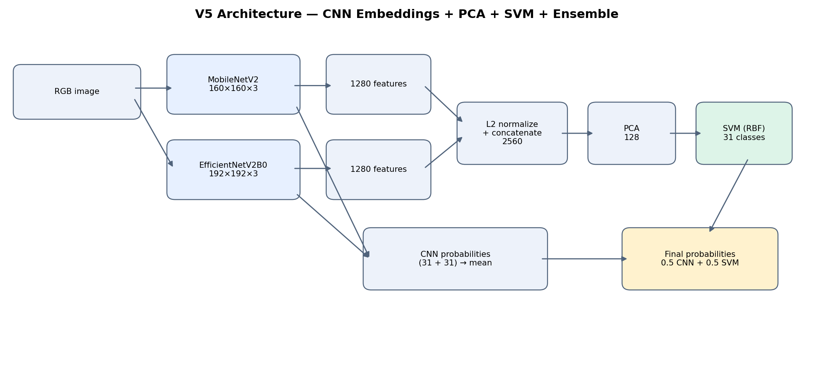

# التعرف على حروف لغة الإشارة العربية | Arabic Sign Language Recognition

**مشروع تعلم عميق ورؤية حاسوبية لتصنيف صور إشارات الحروف العربية الثابتة**

**تطوير:** وهيب الكبودي | Wahib Al-Kaboudi  
**المنصة:** Python / Computer Vision  
**التقنيات:** Python · TensorFlow/Keras · MobileNetV2 · EfficientNetV2B0 · PCA · SVM · Gradio

## نبذة عن المشروع

مشروع رؤية حاسوبية يهدف إلى تصنيف صورة واحدة لإشارة حرف عربي ثابت باستخدام تعلم النقل ومزيج من تمثيلات الشبكات العصبية ومصنفات تعلم الآلة.

## الوظائف والمكونات الأساسية

- إعداد صور وتصنيف إشارات الحروف العربية الثابتة إلى 31 فئة.
- استخراج خصائص من شبكتين عصبيتين مدربتين بالتعلم بالنقل.
- دمج الخصائص وتقليل الأبعاد بـPCA وتصنيفها بـSVM.
- تقييم تجريبي موثق، ورسوم بيانية وتحليل أداء الفئات.
- واجهة Gradio مهيأة لتحليل صورة ثابتة عند توفر ملفات النماذج.

## صور ومخططات المشروع



## التقنيات المستخدمة

Python · TensorFlow/Keras · MobileNetV2 · EfficientNetV2B0 · PCA · SVM · Gradio

## التشغيل محليًا

```bash
python -m pip install -r requirements.txt
python scripts/verify_assets.py --strict
python app.py
```

للتقييم العلمي، راجع `docs/METHODOLOGY_AR.md` و`docs/EVALUATION_AR.md` و`docs/MODEL_CARD_AR.md`.

## حالة المشروع وحدوده

الأوزان الكبيرة للنماذج وملف المصنف غير مرفقة بالحزمة المرسلة؛ لذلك لا تعمل واجهة الاستدلال من هذا المصدر وحده. الدقة المسجلة 88.31% نتيجة استكشافية على تقسيم محدد، وليست ضمانًا للتعميم على أشخاص جدد. المشروع لا يترجم لغة الإشارة المستمرة.

## المطور والترخيص

**إعداد وتطوير المشروع:** وهيب الكبودي | Wahib Al-Kaboudi.

يخضع المصدر البرمجي لترخيص [MIT الخاص بمساھمي المشروع](LICENSE). ولا يشمل هذا الترخيص أوزان النماذج أو مجموعات البيانات أو العناصر الخارجية؛ يُرجى مراجعة وثائق تراخيصها قبل إعادة الاستخدام أو التوزيع.
