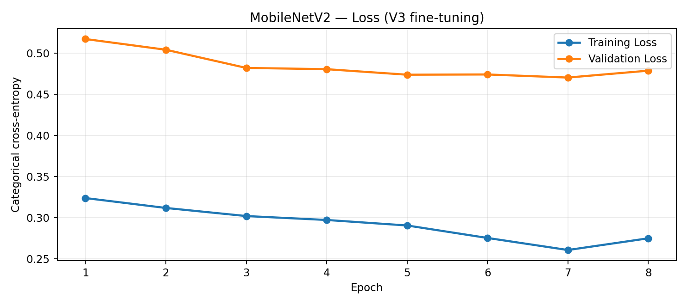
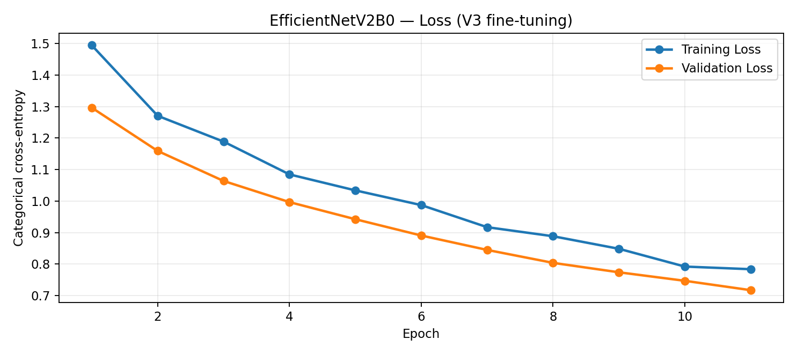
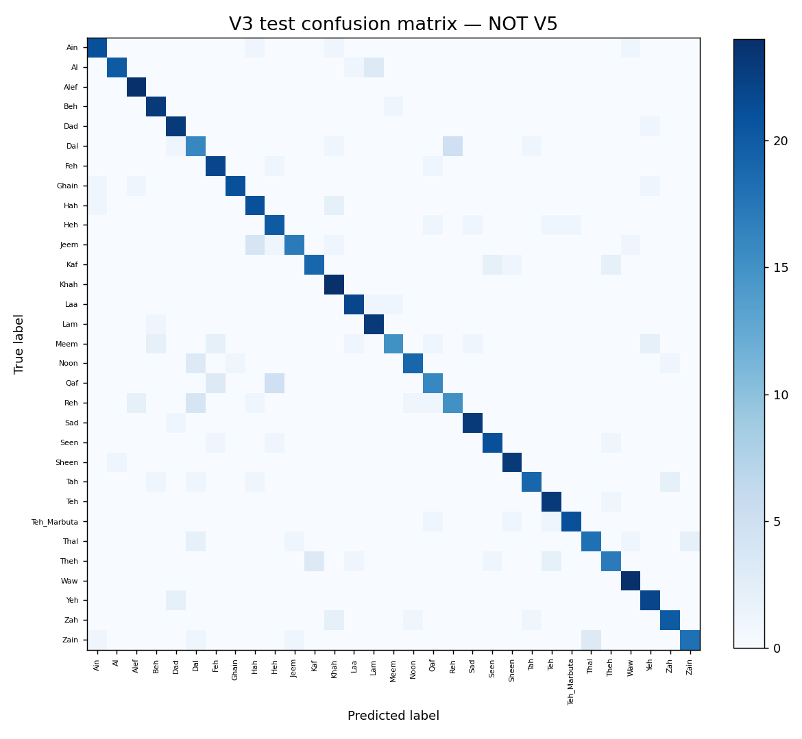

# نتائج التقييم والتحليل

## مؤشرات الإصدار المعتمد V5

| المؤشر | القيمة | التفسير |
|---|---:|---|
| Accuracy على التحقق | 90.19% (671/744) | للمقارنة واختيار إعدادات V5 |
| Accuracy على الاختبار المسجل | **88.31% (657/744)** | اختبار استكشافي سبق استخدامه في تجارب سابقة |
| Macro F1 على الاختبار | **88.24%** | متوسط F1 عبر جميع الفئات |
| عدد الفئات | 31 | إشارات الحروف/الفئات الثابتة |

## تطور نسخ المشروع

| الإصدار | دقة الاختبار التاريخية المسجلة |
|---|---:|
| V1 | 59.95% |
| V2 | 81.18% |
| V3 | 84.68% |
| V5 | **88.31%** |

هذه مقارنة تاريخية على بيانات اختبار سبق استخدامها؛ لا تعادل اختباراً جديداً مستقلاً لكل إصدار.

## اختيار SVM بدلاً من KNN

| المصنّف | دقة التحقق الداخلية (داخل بيانات التدريب) | Macro F1 داخلي |
|---|---:|---:|
| SVM/RBF | 91.03% | 90.71% |
| KNN/Cosine | 79.78% | 79.11% |

تم اعتماد SVM واختبار دمجه مع نموذجَي CNN بناءً على بيانات التحقق.

## المنحنيات والمصفوفة

توضح الرسوم المرفقة منحنيات Fine-Tuning الفعلية لكل شبكة على حدة. الفرق بين Accuracy للتدريب والتحقق معيار لتشخيص فجوة التعميم؛ تقارب المنحنيات وحده ليس دليلاً قاطعاً على الجودة.

**تنبيه بشأن المصفوفة:** الصورة التالية هي مصفوفة الالتباس للإصدار V3، وليست للإصدار V5. لم يتضمن أرشيف V5 التوقعات الفردية اللازمة لإعادة تكوين مصفوفتها كاملة؛ لا ينبغي تقديم مصفوفة V3 على أنها V5.

## حدود التعميم

- لم يُضمن فصل الأشخاص (Signer-disjoint split) بين التدريب والاختبار.
- بيانات الاختبار نفسها استُخدمت عبر نسخ تجريبية؛ لذلك قد تتأثر النتيجة بالاختيارات السابقة.
- يلزم اختبار جديد من أشخاص لم تظهر صورهم في التطوير قبل تقديم ادعاءات عن أداء حقيقي خارج البيانات.
- درجات التنبؤ المجمّعة تقريبية وغير مُعايرة، ولا يصح تفسيرها على أنها ضمان صحيح بنسبة مئوية مماثلة.
