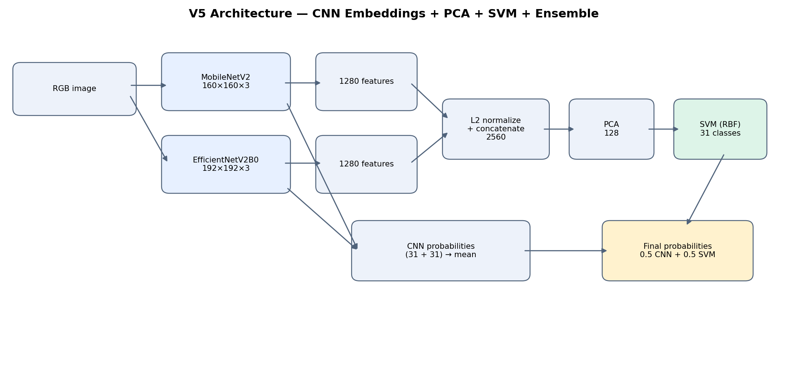
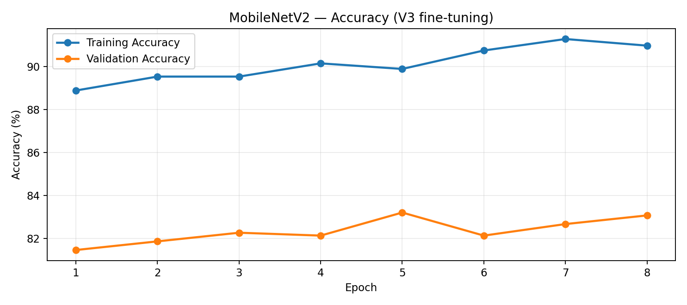
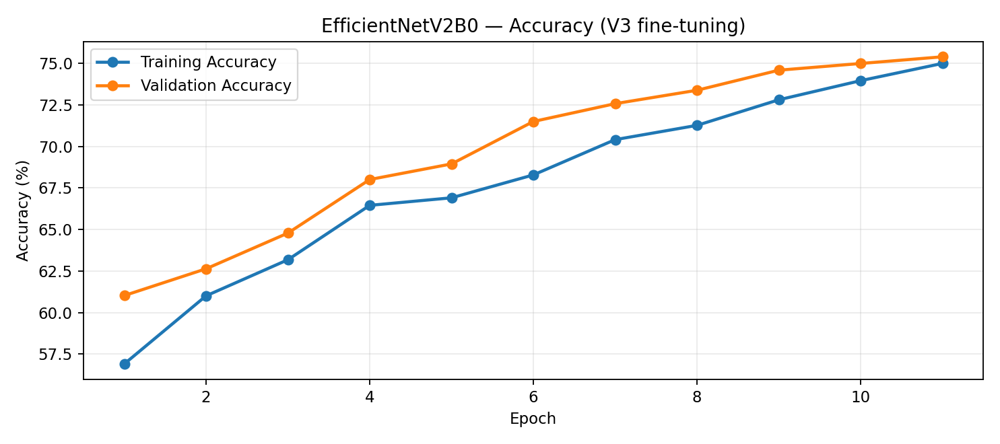

# المنهجية التقنية — الإصدار V5

## 1. تعريف المسألة

تصنيف صورة ملونة RGB تمثل إشارة أبجدية عربية واحدة إلى إحدى 31 فئة. النموذج يعمل على الصور الثابتة وليس الفيديو أو الجمل.

## 2. البيانات والإعداد

المصدر: AASL (انظر ملف `DATASET_AND_LICENSE_AR.md`). جرى الاحتفاظ بعد الفحص بـ **7,653 صورة صالحة**، وتقسيمها إلى **6,165 تدريب** و**744 تحقق** و**744 اختبار**. استُخدم التقسيم على مستوى الصور، ولا يمكن استنتاج استقلال الأشخاص بين الأقسام.

معالجة الصور عند الاستدلال:

1. تصحيح الاتجاه المكتوب في EXIF، وتحويل الصورة إلى RGB.
2. استخدام `tf.image.resize_with_pad` للحفاظ على نسبة العرض إلى الارتفاع، بحجم 160×160 للنموذج الأول و192×192 للثاني.
3. تمرير قيم الصورة بالمدى `[0,255]`. تتضمن الشبكات تطبيعاً داخلياً، لذا إضافة تطبيع خارجي جديد يُغيّر سلوك الاستدلال.
4. لا يُستخدم انعكاس أفقي أثناء التنبؤ لأنه قد يغير معنى الإشارة.

## 3. معمارية الشبكتين

| النموذج | دخل الصورة | خرج الميزات | خرج الفئات | المعالجة |
|---|---|---|---|---|
| MobileNetV2 | `B × 160 × 160 × 3` | `B × 1280` | `B × 31` | Rescaling داخلي |
| EfficientNetV2B0 | `B × 192 × 192 × 3` | `B × 1280` | `B × 31` | معالجة داخلية |

`B` هو حجم الدفعة. طُبّق Fine-Tuning سابقاً باستخدام Learning Rate منخفض، والتوقف المبكر وحفظ أفضل نتائج التحقق.

## 4. النسخة النهائية V5

تُستخرج الميزات من طبقة `global_average_pooling2d` في كل شبكة. تُطبَّع ميزات كل شبكة بمعيار L2 ثم تُدمج (`1280 + 1280 = 2560`). تُخفض الأبعاد إلى **128** بواسطة `PCA` المدرّب على بيانات التدريب، ثم يُستخدم مصنف `SVC` بنواة **RBF** لإنتاج توزيع درجات التصنيف عبر `predict_proba`.

المعادلة المثبتة في `inference_config.json`:

\[
P_{CNN} = 0.5 P_{Mobile} + 0.5 P_{Efficient}, \quad
P_{Final} = 0.5 P_{CNN} + 0.5 P_{SVM}
\]

لا ينبغي تغيير أوزان الدمج أو ترتيب الفئات أو طريقة تطبيع الميزات دون إجراء تدريب وتقييم جديدين.

## 5. منهج الاختيار والتوقف

في V5 جُرّبت SVM/RBF وKNN/Cosine على جزء داخلي من بيانات التدريب. حققت SVM نتيجة أعلى، ثم قورنت درجاتها وتركيبات الدمج بالخط الأساسي على بيانات التحقق. قُبل التحسين عند تجاوزه حد أدنى من عدد الصور الصحيحة إضافياً. تم تقييم الإعداد المقبول بعد الاختيار على اختبار **سبق استخدامه في التجارب السابقة**، لذا يجب وصف نتيجته بأنها استكشافية.

## 6. التفسير والتحقق

تُعرض منحنيات `Training` و`Validation` للنموذج نفسه؛ ارتفاع دقة التدريب دون تحقق قد يدل على فرط التعلّم. `Confusion Matrix` المحفوظة في مراجع المشروع تعود إلى **V3**، ولا يُنسب شكلها إلى V5 دون إعادة حساب توقعات V5 لكل صورة.

## 7. قابلية إعادة الإنتاج

تتضمن الحزمة دفتر V5 لتوثيق الإجراءات ونسخة النموذج النهائي وملفات إعداداته. إعادة التدريب الكامل من الصفر تتطلب بيانات AASL المصدرية والبرمجيات والموارد المناسبة. ثبات النتائج لا يضمنه ضبط `SEED` وحده بين جميع نسخ TensorFlow وGPU.
